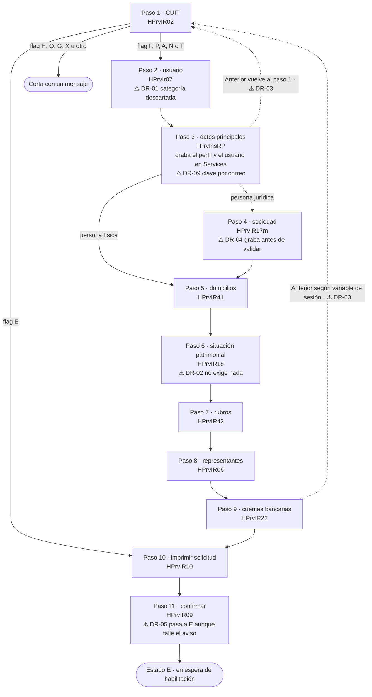
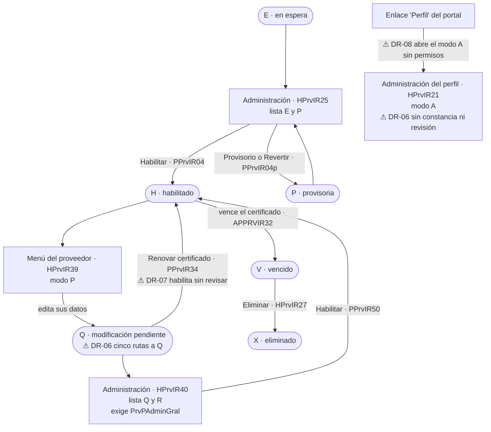

# Mapa de flujos

El módulo Registro de Proveedores de un vistazo: el alta en 11 pasos, la entrada según el estado del proveedor, la modificación de datos (modo `P`), la administración (modo `A`) y la habilitación. Los puntos marcados con ⚠ son puntos de dolor: cada uno enlaza a su decisión en [decisiones-rediseno.md](decisiones-rediseno.md).

Todo sale del código, salvo los pasos 1 a 3 del alta y las pantallas de administración, que se observaron en test el 2026-10-23. El detalle de cada paso está en `pasos/`, el de los estados en `estados.md` y el de los modos en `modos.md`.

## Alta y entrada por CUIT

## Después del alta: modificación, administración y habilitación

## Puntos de dolor

| Marca | Dónde | Decisión |
|---|---|---|
| ⚠ DR-01 | Paso 1 a paso 2: la categoría se calcula y se descarta | [DR-01](decisiones-rediseno.md) |
| ⚠ DR-02 | Paso 6: no exige ejercicio ni balance | [DR-02](decisiones-rediseno.md) |
| ⚠ DR-03 | "Anterior" en los pasos 3, 5, 8 y 9 | [DR-03](decisiones-rediseno.md) |
| ⚠ DR-04 | Paso 4: graba la sociedad antes de validar | [DR-04](decisiones-rediseno.md) |
| ⚠ DR-05 | Paso 11: el estado cambia aunque falle el aviso | [DR-05](decisiones-rediseno.md) |
| ⚠ DR-06 | Modificación de datos en `P` y en `A` | [DR-06](decisiones-rediseno.md) |
| ⚠ DR-07 | Renovar el certificado habilita un `Q` sin revisión | [DR-07](decisiones-rediseno.md) |
| ⚠ DR-08 | Enlace "Perfil" al modo administración | [DR-08](decisiones-rediseno.md) |
| ⚠ DR-09 | Clave inicial en el correo de bienvenida | [DR-09](decisiones-rediseno.md) |

Las demás decisiones (DR-10 a DR-14) no cambian la secuencia del flujo: son de seguridad, datos de cliente, validaciones duplicadas, mensajería y código muerto.
